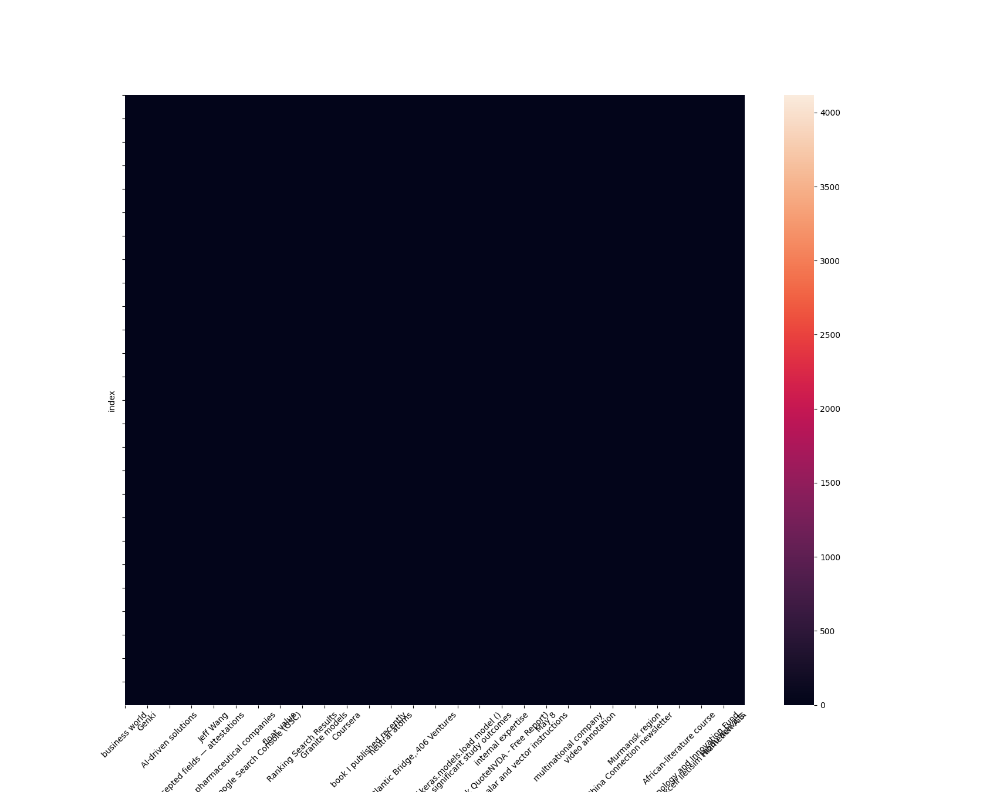

In today’s fast-changing AI landscape, timely and accurate information is crucial. AI breakthroughs in generative models, robotics, natural language processing (NLP), and ethics are reshaping industries and society at large.

This projects aims to advanced NLP techniques to:

-   study AI innovations and debates,
-   track emerging trends over time,
-   analyze sentiment around key technological and ethical issues,
-   experiment with building intelligent applications such as Q&A systems and news monitors (RAG).

However, cleaning and exploration is necessary before any analysis. As such, this notebook's objectives are the following:

-   Cleaning the `ai_media_dataset.csv` ([Kaggle Challenge Source](https://www.kaggle.com/datasets/jannalipenkova/ai-media-dataset?utm_source=chatgpt.com))
-   Exploratory Data Analysis
-   Temporal Analysis of Trends
-   Sentiment Analysis
-   Entities and Relationship Extraction
-   Construction of a Knowledge Graph

```{python}
#| label: imports
#| echo: false
import matplotlib.pyplot as plt
import pickle
import spacy
import numpy as np
from typing import List
import time
import re
from collections import Counter
import pprint
import sys
import pandas as pd
import os
import time
from src.lib import parse_string_into_list
import langextract as lx
import textwrap
import seaborn as sns

from bs4 import BeautifulSoup
import html

import re
from collections import Counter

from langdetect import detect, LangDetectException
```

```{python}
#| label: data loading
#| echo: false
ai_media = pd.read_csv("data/raw/ai_media_dataset.csv")
```

## Overview

The raw datasets contains the following features.

-   `title`: the media's title
-   `date`: the media publication date
-   `content`: list of the media's content chunked by paragraph
-   `domain`: the publication URL domain
-   `url`: the URL of publication
-   `tags`: list of tags classifying the media

```{python}
#| echo: false
ai_media.head()
```

<br>

Features such as `content` and `tags` would need, after parsing, to be standardized. Moreover, we observe different entities and relationships in the dataset. Structuring the data efficiently is key for efficient analysis.

Adopting a *Entity-Relationship Approach*, we observe the following entities and relationships. The schemas has been purposefully kept concise, but modular. If needed, news entities **Chunk** or **Tags** could be created.

<br>

The rational behind separating each media from its chunked content or tags is the following.

First, standardization of the feature is important to avoid anomaly.

Second, both features are important features that will be used throghout the project under different form. For example, the chunked media's content is important to allow the future RAG to grasp on precise part of the corpus. Alternatively, each chunk can be further associated with classes or sentiment for a deeper and granular understanding of the text. On top of that, a granular understand of the text is important for a *Knowledge Graph*. In the future, if each chunk were to be associated with new metrics, creating a unique *Chunk* entity would be wise.

Third, Knowledge Graph (see @sec-kg) requires us to understand the different entities of the data and their relationships. As such, keeping the schema evolving throughout the project will help us in the latter stage tremendously.

::: callout-tip
The goal is to keep this schema evolving throughout the project and our analysis requirements.
:::

::: columns
::: column
-   **Media (Entity)**
    -   `media_id`
    -   `title`
    -   `url`
    -   `full_content`
    -   `domain`
    -   `date`
:::

::: column
-   **Media_has_Chunk (Relationships):**
    -   `media_id`
    -   `chunked_content`
:::

::: column
-   **Media_has_Tags (Relationship)**
    -   `media_id`
    -   `tag`
:::
:::

## Structural Normalization

The initial cleaning process involves parsing both `tags` and `content` variable, as well as extracting the data into the appropriate schemas.

First we create the corresponding **Media** entity table, as well as **Media_has_Chunk** and **Media_has_Tags** relationship tables.

```{python}
#| label: media-table
#| eval: false
stg_media = ai_media.copy()

stg_media["full_content"] = (
	stg_media
	.content
	.apply(lambda content: "".join(parse_string_into_list(content)))
)
media = (
	stg_media
	.loc[:, ["title", "domain", "url", "full_content", "date"]]
	.reset_index()
	.rename(columns={"index": "media_id"})
)
```

```{python}
#| label: media-has-chunk-table
#| eval: false
stg_media_has_chunk = (
	ai_media
	.reset_index()
	.rename(columns={"index": "media_id"})
	.loc[:, ["media_id", "content"]]
)
stg_media_has_chunk["content_list"] = stg_media_has_chunk.content.apply(parse_string_into_list)

media_has_chunk = (
	stg_media_has_chunk
	.explode("content_list", ignore_index=False)
	.drop(columns="content")
	.rename(columns={"content_list": "chunked_content"})
)
```

```{python}
#| label: media-has-tags-table
#| eval: false

stg_media_has_tags = (
	ai_media
	.reset_index().rename(columns={"index": "media_id"})
	.loc[:, ["media_id", "tags"]]
)
stg_media_has_tags["tags_list"] = stg_media_has_tags.tags.apply(parse_string_into_list)

media_has_tags = (
	stg_media_has_tags
	.explode("tags_list", ignore_index=False)
	.drop(columns="tags")
	.rename(columns={"tags_list": "tag"})
)
```

<br>

```{python}
#| label: storing-processed-data
#| eval: false
os.makedirs("data/processed", exist_ok=True)

media.to_csv("data/processed/media.csv", index=False)
media_has_chunk.to_csv("data/processed/media_has_chunk.csv", index=False)
media_has_tags.to_csv("data/processed/media_has_tags.csv", index=False)
```

```{python}
#| echo: false
media = pd.read_csv("data/processed/media.csv")
media_has_chunk = pd.read_csv("data/processed/media_has_chunk.csv")
media_has_tags = pd.read_csv("data/processed/media_has_tags.csv")

media.head()
```

::: columns
::: {.column style="padding-right: 2rem;"}
```{python}
#| echo: false
media_has_chunk.head()
```
:::

::: {.column style="padding-left: 2rem;"}
```{python}
#| echo: false
media_has_tags.head()
```
:::
:::

## Data Cleaning & Quality Control

### Duplicates & Missing Values

**Checking for duplicate articles, either by identical URL or by identical content across different domains.**

```{python}
#| echo: true
#| warning: false

# Remove duplicate articles by URL
duplicates_url = media[media.duplicated(subset="url", keep=False)]
print(f"Duplicate URLs found: {len(duplicates_url)}")
media = media.drop_duplicates(subset="url", keep="first")

# Remove duplicate articles by identical content
duplicates_content = media[media.duplicated(subset="full_content", keep=False)]
print(f"Duplicate content found: {len(duplicates_content)}")
media = media.drop_duplicates(subset="full_content", keep="first")

print(f"Remaining articles after deduplication: {len(media)}")
```


**Check full_content for empty strings or very short texts (near-empty articles)**

```{python}
#| echo: true
#| warning: false

# Inspect short articles before deciding on threshold
media[media["full_content"].str.len() < 100][["title", "full_content"]].head(10)
```

Inspection reveals 3 near-empty articles. Two contain only redirect notices ("updated edition at...") and one has no meaningful content. All three are removed using a 100-character threshold.

```{python}
#| echo: true
#| warning: false

# Check for empty or very short full_content (threshold: 100 characters)
empty_content = media[media["full_content"].isna() | (media["full_content"].str.strip() == "")]
short_content = media[media["full_content"].str.len() < 100]

print(f"Empty content: {len(empty_content)}")
print(f"Very short content (< 100 chars): {len(short_content)}")

# Remove empty and very short articles
media = media[media["full_content"].str.len() >= 100]
print(f"Remaining articles after content length filter: {len(media)}")
```

**Document missing fields systematically (e.g. articles without tags, without domain)**

```{python}
#| echo: true
#| warning: false

# Check for missing values across all tables
print("=== media ===")
print(media.isnull().sum())
print(f"Total articles: {len(media)}\n")

print("=== media_has_chunk ===")
print(media_has_chunk.isnull().sum())
print(f"Total chunks: {len(media_has_chunk)}\n")

print("=== media_has_tags ===")
print(media_has_tags.isnull().sum())
print(f"Total tags: {len(media_has_tags)}\n")

# Articles without any tag
articles_without_tags = media[~media["media_id"].isin(media_has_tags["media_id"])]
print(f"Articles without tags: {len(articles_without_tags)}")
```

```{python}
#| echo: true
#| warning: false

# Remove empty chunks
media_has_chunk = media_has_chunk.dropna(subset=["chunked_content"])
media_has_chunk = media_has_chunk[media_has_chunk["chunked_content"].str.strip() != ""]

print(f"Chunks after removing empty entries: {len(media_has_chunk)}")
```

### Date

**Add date field to the media entity table (currently missing)**

```{python}
#| echo: true
#| warning: false

# Parse date as Datetime type
media["date"] = pd.to_datetime(media["date"])

print(media["date"].dtype)
print(media[["media_id", "title", "date"]].head())
```

**Check for invalid or out-of-range date values**

```{python}
#| echo: true
#| warning: false

# Check for invalid or out-of-range date values
# Dataset should cover September 2024 – September 2025
date_min = pd.Timestamp("2024-09-01")
date_max = pd.Timestamp("2025-09-30")

out_of_range = media[(media["date"] < date_min) | (media["date"] > date_max)]
print(f"Out-of-range dates: {len(out_of_range)}")
print(out_of_range[["media_id", "title", "date"]])
```

```{python}
#| echo: true
#| warning: false

print(f"Total articles: {len(media)}")
```

After removing 1 empty and 3 near-empty articles, 16,383 articles remain within the expected date range (September 2024 – September 2025). No further action required.


### Content Quality

**Strip HTML remnants (<br>, &amp;, &nbsp;, etc.)**

```{python}
#| echo: true
#| warning: false
def clean_html(text):
    # Decode HTML entities (&amp; → &, &nbsp; → space, etc.)
    text = html.unescape(text)
    # Remove HTML tags (<br>, <p>, etc.)
    text = BeautifulSoup(text, "html.parser").get_text()
    return text.strip()

# Apply to full_content and chunked_content
media["full_content"] = media["full_content"].apply(clean_html)
media_has_chunk["chunked_content"] = media_has_chunk["chunked_content"].apply(clean_html)

# Verify with a sample
print(media["full_content"].iloc[0][:300])
```

**Filter out boilerplate text (newsletter prompts, cookie banners, navigation text)**

```{python}
#| echo: true
#| warning: false

# Find most common short sentences across articles (potential boilerplate)
def split_sentences(text):
    return [s.strip() for s in re.split(r'[.!?]', str(text)) if 10 < len(s.strip()) < 150]

all_sentences = media_has_chunk["chunked_content"].apply(split_sentences).explode()
sentence_counts = Counter(all_sentences)

# Show most common sentences
for sentence, count in sentence_counts.most_common(20):
    print(f"{count:5d}x | {sentence}")
```

After some re-runs this is the list of boilerplate patterns that we identified and removed. The patterns are based on the most common sentences found in the dataset, as well as manual inspection of the content. The goal is to remove common boilerplate text that does not contribute meaningful information to the analysis, such as subscription prompts, legal disclaimers, and navigation text.

```{python}
#| echo: true
#| warning: false

boilerplate_patterns = [
    # Rights & legal
    r"all rights reserved",
    r"use of this site is governed by.*?(?=\.|$)",
    r"reproduction in whole or in part.*?(?=\.|$)",
    r"this site is protected by recaptcha.*?(?=\.|$)",
    r"read our privacy policy",
    r"by signing up, you agree.*?(?=\.|$)",
    r"you may unsubscribe at any time",
    r"use the unsubscribe link.*?(?=\.|$)",
    r"in the emails to opt out at any time",
    # Subscriptions & newsletters
    r"thanks for subscribing",
    r"you have successfully joined our subscriber list",
    r"check your inbox for a confirmation email.*?(?=\.|$)",
    r"join our daily and weekly newsletters.*?(?=\.|$)",
    r"if you want to impress your boss.*?(?=\.|$)",
    r"follow tns on your favorite social media.*?(?=\.|$)",
    r"check out the latest featured and trending stories.*?(?=\.|$)",
    r"you can expect all the best tns content.*?(?=\.|$)",
    r"check out more vb newsletters.*?(?=\.|$)",
    r"become a tns follower on linkedin",
    # MarketBeat
    r"marketbeat has identified.*?(?=\.|$)",
    r"five stocks that top analysts.*?(?=\.|$)",
    r"this story was reviewed by marketbeat.*?(?=\.|$)",
    r"please send any questions or comments.*?(?=\.|$)",
    # HPCwire / Tabor
    r"a tabor communications publication",
    r"hpcwire is a registered trademark.*?(?=\.|$)",
    r"-- cray research inc",
    r"-- sun microsystems,?\s*inc",
    r"and sybase,?\s*inc",
    r"recently announced the first benchmark results for sql server 11",
    r"palo alto management group.*?(?=\.|$)",
    r"-- a study by the",
    r"the result represents a n",
    r"new york, ny -- u",
    # Foreign Policy
    r"foreign policy magazine is a division.*?(?=\.|$)",
    r"foreign policy, 655 15th st.*?(?=\.|$)",
    r"i agree to abide by fp'?s comment guidelines",
    # TNS / Data science publications
    r"the world'?s leading publication for data science.*?(?=\.|$)",
    r"your home for data science and a[il]",
    r"community created roadmaps.*?(?=\.|$)",
    r"we'?re so glad you'?re here",
    r"where you can adjust your preferences.*?(?=\.|$)",
    r"while you wait for your first tns newsletter",
    # Generic
    r"an error occured",
    r"\(\s*read more\s*\)",
    r"read more…",
    r"\(\s*required\s*\)",
    r"https:\s*//www",
    r"by clicking submit.*?(?=\.|$)",
    r"by submitting your email.*?(?=\.|$)",
    r",?\s*you agree to the privacy policy.*?(?=\.|$)",
    r"to share your email address with tfn.*?(?=\.|$)",
    r"mountain view,?\s*calif",
    # Boilerplate tool descriptions
    r"the tool offers real-time insights.*?(?=\.|$)",
    r"the tool generates executive summaries.*?(?=\.|$)",
    r"the solution enhances due diligence.*?(?=\.|$)",
]

def remove_boilerplate(text):
    if not isinstance(text, str):
        return text
    for pattern in boilerplate_patterns:
        text = re.sub(pattern, "", text, flags=re.IGNORECASE)
    return text.strip()

media["full_content"] = media["full_content"].apply(remove_boilerplate)
media_has_chunk["chunked_content"] = media_has_chunk["chunked_content"].apply(remove_boilerplate)

# Drop empty chunks
media_has_chunk = media_has_chunk.dropna(subset=["chunked_content"])
media_has_chunk = media_has_chunk[media_has_chunk["chunked_content"].str.strip() != ""]

print(f"Chunks after cleaning: {len(media_has_chunk)}")
```

Let's verify that the boilerplate removal worked by checking the most common sentences again. The previously identified boilerplate sentences should no longer appear in the top results.

```{python}
#| echo: true
#| warning: false

# Again: Show most common sentences
all_sentences = media_has_chunk["chunked_content"].apply(split_sentences).explode()
sentence_counts = Counter(all_sentences)

for sentence, count in sentence_counts.most_common(20):
    print(f"{count:5d}x | {sentence}")
```

After several iterations of boilerplate removal, residual patterns remain in less than 0.2% of all chunks. The high `nan` count in the sentence analysis is an artefact of the analysis function itself, not a data issue — empty chunks have already been removed via `dropna`. Further cleaning yields diminishing returns and risks removing legitimate content. We therefore consider the boilerplate removal sufficient for downstream NLP tasks.


**Check for suspiciously old content (mentions of outdated technologies, companies, etc.)**

```{python}
#| echo: true
#| warning: false

# Investigate suspicious old content
suspicious = media[media["full_content"].str.contains("Cray Research|Sun Microsystems|SQL Server 11", case=False, na=False)]
print(f"Suspicious articles: {len(suspicious)}")
suspicious[["media_id", "title", "date", "domain"]].head(10)
```

```{python}
#| echo: true
#| warning: false

# Inspect the actual content of one suspicious article
print(media[media["media_id"] == 28]["full_content"].values[0][:1000])
```

Upon inspection, the suspicious articles originate mostly from hpcwire and contain legitimate AI/HPC content. The old references (e.g. Cray Research, Sun Microsystems) appear to be historical comparisons embedded within otherwise relevant articles. We  herefore keep these articles as is.


**Identify and handle chunks that are too short (e.g. < 50 characters)**

```{python}
#| echo: true
#| warning: false

# Identify chunks that are too short (< 50 characters)
short_chunks = media_has_chunk[media_has_chunk["chunked_content"].str.len() < 50]
print(f"Short chunks (< 50 chars): {len(short_chunks)}")
print(short_chunks["chunked_content"].head(20))
```

```{python}
#| echo: true
#| warning: false

# Remove chunks that are too short (< 50 characters)
media_has_chunk = media_has_chunk[media_has_chunk["chunked_content"].str.len() >= 50]

print(f"Chunks after removing short entries: {len(media_has_chunk)}")
```


**Detect and handle non-English articles (filter out or flag separately)**

```{python}
#| echo: true
#| warning: false
def detect_language(text):
    try:
        return detect(str(text))
    except LangDetectException:
        return "unknown"

# Detect language on full_content
media["language"] = media["full_content"].apply(detect_language)

# Show distribution
print(media["language"].value_counts().head(10))
```

```{python}
#| echo: true
#| warning: false

# Keep only English articles
media = media[media["language"] == "en"]

# Remove language column (no longer needed)
media = media.drop(columns=["language"])

# Sync media_has_chunk and media_has_tags
media_has_chunk = media_has_chunk[media_has_chunk["media_id"].isin(media["media_id"])]
media_has_tags = media_has_tags[media_has_tags["media_id"].isin(media["media_id"])]

print(f"Articles after language filter: {len(media)}")
print(f"Chunks after language filter: {len(media_has_chunk)}")
print(f"Tags after language filter: {len(media_has_tags)}")
```

### Tags

**Normalize tag variants (e.g. GenerativeAI vs Generative_AI vs generative-ai)**

```{python}
#| echo: true
#| warning: false

# Inspect current tag distribution
print(f"Total unique tags: {media_has_tags['tag'].nunique()}")
print(media_has_tags["tag"].value_counts().head(20))
```

```{python}
#| echo: true
#| warning: false

# Check for case variants (e.g. "GenerativeAI" vs "generativeai" vs "Generativeai")
tag_groups = media_has_tags.groupby(media_has_tags["tag"].str.lower())["tag"].unique()
case_variants = tag_groups[tag_groups.apply(len) > 1]
print(f"Tags with case variants: {len(case_variants)}")
print(case_variants)
```

Tags are consistently formatted in CamelCase with no case variants detected.

```{python}
#| echo: true
#| warning: false

# Check for tags with leading/trailing whitespace
whitespace_tags = media_has_tags[media_has_tags["tag"] != media_has_tags["tag"].str.strip()]
print(f"Tags with whitespace issues: {len(whitespace_tags)}")
```

```{python}
#| echo: true
#| warning: false

media_has_tags["tag"] = media_has_tags["tag"].str.strip()
print("Whitespace removed.")
```

One tag with leading/trailing whitespace was stripped. No other normalization issues were detected. The tag data is now clean and ready for analysis.


## Exploratory Analysis

::: callout-warning
This section needs to be implemented
:::

## Temporal Analysis

::: callout-warning
This section needs to be implemented
:::

## Sentiment Analysis

::: callout-warning
This section needs to be implemented
:::

## Entities and Relationship Extraction

Previous section focused on explorations and trends analysis.
This section builds on-top of them, extracting the main entities of the news articles and their relationships.
Those extracted information will be the core components of our knowledge graph.

Since our knowledge needs to represent the articles content and map it faithfully,
let's have a look at the main entities present in the articles.

### Entities Distribution

```{python}
#| label: "load-nlp-model"
nlp = spacy.load("en_core_web_trf")
```

Using `spaCy` built-in entity recognizer, we can get an generally overview that the main entities that the articles contains, as well as potential relationships.

```{python}
#| label: "spacy-entities-list"
# Source - https://stackoverflow.com/a/70188495
# Posted by aab
# Retrieved 2026-02-26, License - CC BY-SA 4.0

entities = {ent: spacy.explain(ent) for ent in nlp.get_pipe("ner").labels}
pprint.pp("List of recognized entities by spacY and their description:")
pprint.pp(entities)
```

Running the following multiple times, we observe that organizations (`ORG`), products (`PRODUCT`), persons (`PERSON`) and dates (`DATE`)
consistently rank among the most present entities. They are followed by numerical values such as money (`MONEY`) or percentages (`PERCENT`). Alternatively, location, such as cities or countries are also well-documented ("GPE").

Without context, it hard to know whether persons are are public figures, researchers, CEO, or even the author himself.
Organizations `ORG` are mostly be public institutions, such as universities, or privates companies.

Products are most often AI products or model name, such as "Claude 3.5", while

Overall, we retain 3 major entities: persons, organizations, products and countries.
The rests can be considered as informations suplementing those entities and their relationships, mainly money, such as how much a model costed, or date, as when the model was published.

```{python}
#| label: "most-common-entities"
list_articles_content = media.full_content.values
np.random.seed(25)
sample_articles = np.random.choice(list_articles_content, size=30)
sample_content = "".join(sample_articles)
docs = nlp(sample_content)

ent_list = [token.ent_type_ for token in docs if token.ent_type != ""]
for ent, count in Counter(ent_list).most_common(20):
	print(f"{ent}: {count}")
```

```{python}
#| label: "most-common-entities-with-text"
mapping = {token.text: token.ent_type_ for token in docs[:10] if token.ent_type_ != ""}
pprint.pp(mapping)
```

Combining those entities with the articles data that we have: publisher and date of publications and tags, we can effectively map trends and AI research developement.

### Extraction Pipeline

`LangExtract` is a powerful open-source library that enables efficient and performant entity and relatioships extraction.
It uses LLM begin the scene, constructing and formatted and precise response.
Ensuring easy reproducibility of the pipeline, we'll use an open-source model.


Moreover, we'll give as input the whole articles, instead of its chunks.
This will enable the model to have an optimal understand of the context, hopefully increasing the extraction quality.
Moreover, as the extraction also provided the actual location of the entities, we'll be able to match those entities to there corresponding chunks, ensuring compatilbity for the future RAG implement and pipeline.

```{python}
#| code-fold: true
#| label: "langextract-prompt-and-examples"
# 1. Define the prompt and extraction rules
prompt = textwrap.dedent("""\
    	Extract entities such as organizations name, products such as AI models, persons and countries or locations.
	Provide meaningful attributes for each entity to add context.
	For each entities, extract their relationships with each other.
	A extraction of class "relationship" must always relate to 2 entities minimum.
    Use exact text for extractions. Do not paraphrase or overlap entities.
    """)

# 2. Provide a high-quality example to guide the model
examples = [
    lx.data.ExampleData(
        text="Carnegie Mellon University’s new Robotics Innovation Center (RIC) has signed robotics company FieldAI as its first corporate tenant ahead of the facility’s formal opening in February 2026, embedding the AI-driven robotics unicorn into a 2,500 sq ft lab to advance physical AI and real-world robot deployment in complex environments",
        extractions=[
            lx.data.Extraction(
                extraction_class="entity",
                extraction_text="Carnegie Mellon University",
                attributes={"type": "university"}
            ),
            lx.data.Extraction(
                extraction_class="entity",
                extraction_text="new Robotics Innovation Center (RIC)",
                attributes={"type": "research_center"}
            ),
            lx.data.Extraction(
                extraction_class="relationship",
                extraction_text="new Robotics Innovation Center (RIC)",
		attributes={"type": "affiliation", "party": ["Carnegie Mellon University", "Robotics Innovation Center (RIC)"], "money_amount": "unkown", "beneficiary": "unkown"}
            ),
            lx.data.Extraction(
                extraction_class="entity",
                extraction_text="FieldAI",
                attributes={"type": "company"}
            ),
            lx.data.Extraction(
                extraction_class="relationship",
                extraction_text="has signed robotics company FieldAI as its first corporate tenant in February 2026",
		attributes={"type": "partnership", "date": "February 2026", "party": ["Carnegie Mellon University", "FieldAI"], "money_amount": "unkown", "beneficiary": "FieldAI" }
            ),
	]
	),
    lx.data.ExampleData(
        text="Robotics startup Figure AI Inc. exceeded $1 billion in Series C funding at a $39 billion post-money valuation in September 2025, enabling it to scale production of its AI-powered humanoid robots (including Figure 02 and Figure 03) and expand the Helix embodied-intelligence platform with major investors such as NVIDIA, Intel Capital, and Brookfield Asset Management.",
        extractions=[
            lx.data.Extraction(
                extraction_class="entity",
                extraction_text="Figure AI Inc.",
                attributes={"type": "company"}
            ),
            lx.data.Extraction(
                extraction_class="entity",
                extraction_text="its AI-powered humanoid robots",
		attributes={"type": "product", "owned_by": "Figure AI Inc."}
            ),
            lx.data.Extraction(
                extraction_class="entity",
                extraction_text="Helix embodied-intelligence platform",
		attributes={"type": "product", "owned_by": "Figure AI Inc.", "product_name": "Helix embodied-intelligence platform"}
            ),
            lx.data.Extraction(
                extraction_class="entity",
                extraction_text="NVIDIA",
                attributes={"type": "company"}
            ),
            lx.data.Extraction(
                extraction_class="entity",
                extraction_text="Intel Capital",
                attributes={"type": "company"}
            ),
            lx.data.Extraction(
                extraction_class="entity",
                extraction_text="Brookfield Asset Management",
                attributes={"type": "company"}
            ),
            lx.data.Extraction(
                extraction_class="relationship",
                extraction_text="exceeded $1 billion in Series C funding",
		attributes={"type": "partnership", "party": ["Figure AI Inc", "NVIDIA", "Intel Capital", "Brookfield Asset Management"], "money_amount": "1000000000", "beneficiary": "Figure AI Inc"}
            ),
        ]
    ),
    lx.data.ExampleData(
        text="Google announced it is folding its AI robotics project Intrinsic back into the parent company as a dedicated group aligned with Google DeepMind to accelerate development of AI models like Gemini Robotics for physical control systems, marking a strategic shift to unify robotics software and embodied AI under core Alphabet AI teams",
        extractions=[
            lx.data.Extraction(
                extraction_class="entity",
                extraction_text="Google",
                attributes={"type": "company"}
            ),
            lx.data.Extraction(
                extraction_class="entity",
                extraction_text="its AI robotics project Intrinsic",
		attributes={"type": "product", "owned_by": "Figure AI Inc.", "product_name": "Intrinsic"}
            ),
            lx.data.Extraction(
                extraction_class="entity",
                extraction_text="Google DeepMind",
		attributes={"type": "research_group", "owned_by": "Google"}
            ),
            lx.data.Extraction(
                extraction_class="entity",
                extraction_text="accelerate development of AI models like Gemini Robotics",
		attributes={"type": "product", "owned_by": "Google", "product_name": "Gemini Robotics"}
            ),
        ]
    )
]
```

For a easily evaluable test case, we'll use a small article using a lightweight open-source model `gemma3:4b`.
On the first try, the model detected entities and relationships mostly successfully, with a few detected entities bringing few information.
Examples are isolated "financial_amount" extraction, that can be bound to no other entities.

That said, isolated extracted entities could be removed and not taken into account when constructing the graph.
Morevoer, inference time is consequent. As such, running the whole dataset using this model is unfeasible.
As a matter of fact, even running the extraction on the whole daset using the smaller model is unfeasible, as extraction lasts around 1 minutes for each articles.
As such, we'll only be able to extract entities from a sample of the articles.

```{python}
#| eval: false
#| label: "entities-extraction"
media["content_length"] = media.full_content.str.len()
sample = media.sort_values(by="content_length", ascending=True).reset_index().iloc[5]
# The input text to be processed
input_text = sample.full_content

print("**Article's Content:** \n", input_text)
# Run the extraction
result = lx.extract(
    text_or_documents=input_text,
    prompt_description=prompt,
    examples=examples,
    model_id="gemma3:27b",  # Automatically selects Ollama provider
    model_url="http://localhost:11434",
    fence_output=False,
    use_schema_constraints=False
)
```

```{python}
#| eval: false
#| echo: false
#| label: "langextract-save-visualization"
lx.io.save_annotated_documents([result], output_name="extraction_results.jsonl", output_dir=".")
html_content = lx.visualize("notebook/extraction_results.jsonl")
with open("notebook/visualization.html", "w") as f:
    if hasattr(html_content, 'data'):
        f.write(html_content.data)  # For Jupyter/Colab
    else:
        f.write(html_content)
```

<br>

{width="100%" height="600px"}

```{python}
#| echo: false
#| eval: false
#| label: "langextract-runtime-evaluation"

def extract(
	documents: list[lx.data.Document],
	prompt: str = prompt,
	examples: str = examples,
	model_name: str = "gemma3:4b"
) -> list[lx.data.AnnotatedDocument] | lx.data.AnnotatedDocument:
	result = lx.extract(
		text_or_documents=documents,
		prompt_description=prompt,
		examples=examples,
		model_id=model_name,
		
		# Parameters for extraction - ALWAYS USE BATCH API
		extraction_passes=2,       # Multiple passes for better recall
		max_char_buffer=2000,      # Moderate chunks (~124 chunks)
		max_workers=1,             # Sequential (not used with batch)
		batch_length=1000,         # Process all chunks in one batch job
		show_progress=True,
		resolver_params={
		    "suppress_parse_errors": True,  # Skip chunks where LLM returns malformed JSON
		}
	)
	return result
```

```{python}
#| label: "extraction-pipeline"
#| eval: false
articles = media.loc[:, ["media_id", "full_content"]].sample(n=400)

extracted_documents: List[dict] = []
count = -1
for i, (media_id, text) in articles.iterrows():
	count += 1
	print(f"Article {count} / 399")
	try:
		result = extract(text)
		extracted_documents.append(
			{
				"media_id": media_id,
				"extraction": result
			}
		)
	except Exception as error:
		print(f"Error: {error}")
		continue

with open("notebook/langextract_extraction_results.pkl", "wb") as fb:
	pickle.dump(extracted_documents, fb)
```

```{python}
#| label: "langchain-result-parsing"
#| eval: false

from src.lib import langextract_to_json

json_annotations: List[dict] = []
for doc in documents:
	flattened_extraction = langextract_to_json(
	    doc["media_id"], doc["extraction"]
	)
	json_annotations.extend(flattened_extraction)

with open(
	"data/processed/langchain_extractions_json.pkl", "wb"
) as file:
        pickle.dump(json_annotations, file)

```

```{python}
#| label: "flattened-annotations-loading"

with open("data/processed/langextract_extractions_json.pkl", "rb") as file:
	extract = pickle.load(file)
```

### Extraction Exploration

Out of all the entities extracted, the most common entities extracted revolved around
Google and related search team or product, such as Google DeepMind, Gemini Robotics or Intrinsic.
Unsurprisingly, China and United States (or U.S.) also appear very often the 'AI-race' between the USA and China,
is a term mentioned, at least in the Western part of the world.

Interestingly, Russia is also a entity that appears often, although they seems relatively quiet in the AI space.

```{python}
#| label: most-common-langextract-entities 

entities_counts = Counter([ex["entity"]["entity_text"] for ex in extract if "entity" in ex.keys()])
n_unique_entities = len(entities_counts.keys())

print("Total Amount of Unique Entities: ", n_unique_entities)
print("Total Amount of Extracted Entities: ", entities_counts.total())
print("Top 20 - Most Common Entities: ")
for name, count in entities_counts.most_common(20):
	print(f"   + {name}: {count}")
```

As the amount of diversed entities extracted is high, we expect the co-occurence matrix to be very sparse.
Moreover, some entites are simply written in a different way, contributing to the sparsity effect, such as 'NVIDIA' and 'Nvidia Corp.'
Additionnaly, as we could expect the distribution of entities across media is akin to a power-law distribution.

```{python}
#| label: extract-entities-distributions

fig, ax = plt.subplots()
pd.Series(entities_counts).sort_values(ascending=False).plot(kind="line", ax=ax)
ax.tick_params("x", rotation=45)
ax.set_title("Extracted Entities Distribution (N_articles=400)")
ax.set_ylabel("Count")
ax.set_xlabel("Entities")
plt.show()
```

```{python}
#| label: co-occurrence-matrix
#| eval: false
entities_per_media = defaultdict(list) 

# Get a list of entities mentioned in each media for each media
for ex in extract:
	if "entity" in ex.keys():
		entities_per_media[ex["media_id"]].append(ex["entity"]["entity_text"])

media_id_list = list(entities_per_media.keys())
coc_matrix = np.zeros((n_unique_entities, n_unique_entities)) # Empty co-occurrence matrix
# Map each entities to their corresponding column/row index
idx_mapping = {ent: idx for idx, ent in enumerate(entities_counts.keys())}

for media_id in media_id_list:
	entities_list = np.array(entities_per_media[media_id])
	for ent in entities_list:
		# Get all entities inside the list except the current `ent`
		neighbors = entities_list[np.not_equal(entities_list, ent)]
		# Increase the occurrence of `ent` with all neighbors
		for neigh in neighbors:
			coc_matrix[idx_mapping[ent], idx_mapping[neigh]] += 1

coc_df = pd.DataFrame(coc_matrix, columns=idx_mapping.keys(), index=idx_mapping.keys())
coc_df.to_csv("data/processed/co_occurrence_matrix.csv", index=False)
coc_df.to_parquet("data/processed/co_occurrence_matrix.parquet", engine="fastparquet")
```

```{python}
#| label: load-co-occurrence-matrix
coc = pd.read_parquet("data/processed/co_occurrence_matrix.parquet", engine="fastparquet")
```

```{python}
#| label: heatmap-co-occurrence-matrix
#| eval: false
fig, ax = plt.subplots()
sns.heatmap(coc, ax=ax)
ax.tick_params("x", rotation=45)
plt.show()
plt.savefig("notebook/heatmap-co-occurrence-matrix.png")
```

As expected, sparsity is very high and it is hard to see which entity text is most often associated with.
Enabling a better visualization of cluster, we'll reduce dimensionality by using a **t-Distribution Stochastic Neighbor Embedding** (TSNE) algorithm.
Contrary to other dimensionality reductio techniques, this algorithm preserve global structure by increasing density around core clusters.
As our co-occurrence matrix can be considered a 'similarity' matrix, we do not need any further preprocessing.
As per the very peculiar distribution, we won't use a scaling step as to avoid messing with the relationships strength between entities.
Further supporting this claim, a trial with scaling deliver much worse result in terms of clusters.



```{python}
#| eval: false
#| label: tsne-dim-reduction

from sklearn.manifold import TSNE
from sklearn.pipeline import Pipeline
from sklearn.preprocessing import MinMaxScaler

pipe = Pipeline(
	steps=[
	## ("scaler", MinMaxScaler()),
	("tsne", TSNE())
	]
)
coc_reddim = pipe.fit_transform(coc)
coc_reddim_df = pd.DataFrame(
	np.concat((coc_reddim, coc_df.columns.to_numpy()[:, np.newaxis]), axis=1),
	columns=["x", "y", "entity_text"]
)

coc_reddim_df.to_csv("data/processed/reduced-co-occurrence-matrix.csv", index=False)
```

```{python}
#| label: "load-coc-reddim"
coc_reddim_df = pd.read_csv("data/processed/reduced-co-occurrence-matrix.csv")
```

Hovering over clusters of point, the user can them and the corresponding entities.
Nevertheless, as per the entity distribution, we observe a a few large conglomerates of points at the center, with many small clusters, many of them consisting of 2 or 3 entities.

As expected, major actors (company, entities or product) in the AI space such as AI Model, Artificial Intelligence, NVIDIA, ... flock together in a big area.

However, within this area, smaller groups can be observed.
For example, we can observe a group involving "data privacy", "GDPR", "AI Model" and "Generative AI".
This presence of this group at the center of the bigger cluster shows that data privacy and governement isn't a small trend,
it is very much a concerns for the public.

Furthermore, we can observe entities such as "Trump Administration", "Biden" and countries such as "China" or "USA" close to other technical entities such as "Large Language Model".
This further cement the fact that technological advancement if tighly tied with politics and countries agenda.
Naturally, given the potential of modern AI technologies and their promises, it is expected that major powers are pulling strings.

```{python}
#| label: plotly-reduced-co-occurrence-matrix
import plotly.express as px

fig = px.scatter(coc_reddim_df, x="x", y="y", hover_data=["entity_text"])
fig.show()
```

## Knowledge Graph {#sec-kg}

A knowledge graph is a way of depicting data in a highly relational way, akin to a mindmap. This allows a deep understanding and precise querying of entities and their relationships.

Moreover, its data model mainly consists of 3 main components: node, relationships and properties. A node is corresponds to a data entities, while relationships are how different entities relate to each other. Moreover, properties are way to describe **both** node and relationships.

::: callout-tip
See [Neo4j - Data Modelling](https://neo4j.com/docs/getting-started/data-modeling/) for more informations
:::

Its purpose, akin to a mindmap, is to create a precise and deep map of knowledge. Quality, rather that quantity, is were a Knowledge Graph seems to truly shines. As such, in the following section, we aim a creating a graph that focus on answering the following questions.

::: callout-warning
This section needs to be implemented, though staring by figuring out the main questions we want to answer is a good starting point.
:::
