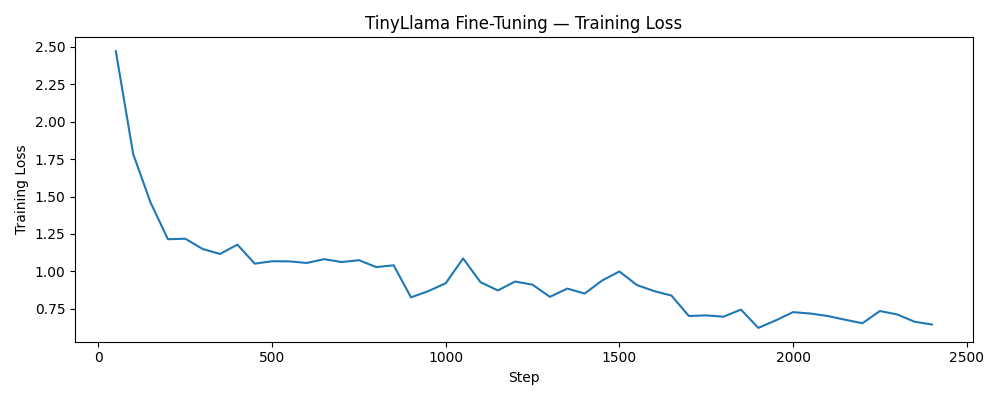
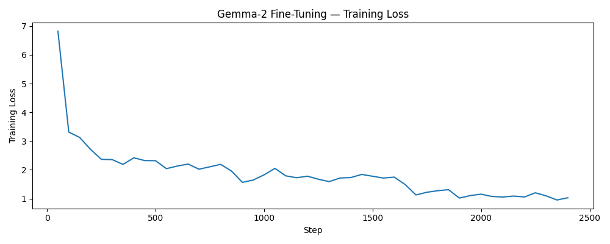

# Fine-Tuning Compact LLMs for Sentiment Classification

This chapter fine-tunes two compact open-source LLMs for three-class sentiment classification
(negative / neutral / positive) using `AutoModelForSequenceClassification` with QLoRA
(4-bit quantization + LoRA adapters). The model outputs a label directly via softmax -
no text generation needed. Both models were trained on Google Colab Pro (A100 GPU).

Code execution is disabled in Quarto (`eval: false`) because training runs in Colab,
not during book rendering. Results are hardcoded after each run.

## Install dependencies

```{python}
#| label: install-dependencies
#| echo: true
#| eval: false

!pip install -q transformers peft bitsandbytes accelerate datasets pyarrow
```

## Imports

```{python}
#| label: imports
#| echo: true
#| eval: false

import pandas as pd
import numpy as np
import torch

from pathlib import Path
from datasets import Dataset
from transformers import (
    AutoTokenizer,
    AutoModelForSequenceClassification,
    BitsAndBytesConfig,
    TrainingArguments,
    Trainer,
)
from peft import LoraConfig, get_peft_model, prepare_model_for_kbit_training
from sklearn.metrics import f1_score, classification_report
```

## Shared Configuration

Both models use identical hyperparameters and data - only `MODEL_NAME` and the output paths differ.

```{python}
#| label: config
#| echo: true
#| eval: false

SEED       = 42
MAX_LENGTH = 512
LABEL2ID   = {"negative": 0, "neutral": 1, "positive": 2}
ID2LABEL   = {0: "negative", 1: "neutral", 2: "positive"}
```

## Mount Google Drive and load data

```{python}
#| label: colab-drive-and-load-data
#| echo: true
#| eval: false

from google.colab import drive
drive.mount("/content/drive")

PROJECT_DIR = Path("/content/drive/MyDrive/CLT/project")

train_df = pd.read_parquet(PROJECT_DIR / "train.parquet")
test_df  = pd.read_parquet(PROJECT_DIR / "test.parquet")

print(f"Train: {len(train_df):,}  |  Test: {len(test_df):,}")
print(train_df["sentiment_label"].value_counts())
```

## Prepare datasets

We recode `(partly) negative` to `negative`, tokenize `full_content` (truncated to 512 tokens),
and map string labels to integers.

```{python}
#| label: recode-sentiment
#| echo: true
#| eval: false

train_df["sentiment_label"] = train_df["sentiment_label"].str.replace("(partly) negative", "negative")
test_df["sentiment_label"]  = test_df["sentiment_label"].str.replace("(partly) negative", "negative")
```

```{python}
#| label: prepare-datasets
#| echo: true
#| eval: false

tokenizer = AutoTokenizer.from_pretrained(MODEL_NAME)

if tokenizer.pad_token is None:
    tokenizer.pad_token = tokenizer.eos_token

def tokenize(batch):
    enc = tokenizer(
        batch["full_content"],
        truncation=True,
        max_length=MAX_LENGTH,
        padding="max_length",
    )
    enc["labels"] = [LABEL2ID[l] for l in batch["sentiment_label"]]
    return enc

train_dataset = Dataset.from_pandas(train_df[["full_content", "sentiment_label"]]) \
    .map(tokenize, batched=True, remove_columns=["full_content", "sentiment_label"])

test_dataset  = Dataset.from_pandas(test_df[["full_content", "sentiment_label"]]) \
    .map(tokenize, batched=True, remove_columns=["full_content", "sentiment_label"])

train_dataset.set_format("torch")
test_dataset.set_format("torch")
```

## Configure 4-bit quantization

```{python}
#| label: quantization-config
#| echo: true
#| eval: false

bnb_config = BitsAndBytesConfig(
    load_in_4bit=True,
    bnb_4bit_quant_type="nf4",
    bnb_4bit_compute_dtype=torch.float16,
    bnb_4bit_use_double_quant=True,
)
```

## Configure LoRA

```{python}
#| label: lora-config
#| echo: true
#| eval: false

peft_config = LoraConfig(
    r=16,
    lora_alpha=32,
    lora_dropout=0.05,
    bias="none",
    task_type="SEQ_CLS",
    target_modules=["q_proj", "v_proj"],
)
```

## Metrics function

```{python}
#| label: metrics-fn
#| echo: true
#| eval: false

def compute_metrics(eval_pred):
    logits, labels = eval_pred
    preds = np.argmax(logits, axis=-1)
    macro_f1 = f1_score(labels, preds, average="macro")
    return {"macro_f1": macro_f1}
```

---

# Model 1 - TinyLlama 1.1B

TinyLlama 1.1B is a compact open-source decoder model trained on 3 trillion tokens. Despite
its small size, it provides strong general language understanding and trains efficiently with
QLoRA on an A100 GPU.

## Load model

```{python}
#| label: load-model-tinyllama
#| echo: true
#| eval: false

MODEL_NAME = "TinyLlama/TinyLlama-1.1B-Chat-v1.0"

model = AutoModelForSequenceClassification.from_pretrained(
    MODEL_NAME,
    num_labels=3,
    id2label=ID2LABEL,
    label2id=LABEL2ID,
    quantization_config=bnb_config,
    device_map="auto",
)

model.config.pad_token_id = tokenizer.pad_token_id
model = prepare_model_for_kbit_training(model)
model = get_peft_model(model, peft_config)
model.print_trainable_parameters()
```

## Training arguments

```{python}
#| label: training-args-tinyllama
#| echo: true
#| eval: false

training_args = TrainingArguments(
    output_dir="outputs/tinyllama-sentiment",
    per_device_train_batch_size=8,
    gradient_accumulation_steps=2,
    num_train_epochs=3,
    learning_rate=2e-4,
    logging_steps=50,
    save_strategy="no",
    report_to="none",
    fp16=True,
    seed=SEED,
)
```

## Train

```{python}
#| label: run-training-tinyllama
#| echo: true
#| eval: false

trainer = Trainer(
    model=model,
    args=training_args,
    train_dataset=train_dataset,
    eval_dataset=test_dataset,
    compute_metrics=compute_metrics,
)

trainer.train()
```

## Training loss curve

```{python}
#| label: training-loss-curve-tinyllama
#| echo: true
#| eval: false

import matplotlib.pyplot as plt

loss_log = trainer.state.log_history
steps  = [x["step"] for x in loss_log if "loss" in x]
losses = [x["loss"] for x in loss_log if "loss" in x]

plt.figure(figsize=(10, 4))
plt.plot(steps, losses)
plt.xlabel("Step")
plt.ylabel("Training Loss")
plt.title("TinyLlama 1.1B - Training Loss")
plt.tight_layout()
plt.savefig(PROJECT_DIR / "tinyllama_training_loss.png")
plt.show()
```

## Evaluate and save

```{python}
#| label: evaluate-tinyllama
#| echo: true
#| eval: false

predictions   = trainer.predict(test_dataset)
y_pred        = np.argmax(predictions.predictions, axis=-1)
y_true        = predictions.label_ids
y_pred_labels = [ID2LABEL[i] for i in y_pred]
y_true_labels = [ID2LABEL[i] for i in y_true]

macro_f1 = f1_score(y_true_labels, y_pred_labels, average="macro",
                    labels=["negative", "neutral", "positive"])

print(f"Macro-F1: {macro_f1:.4f}")
print(classification_report(y_true_labels, y_pred_labels,
                             labels=["negative", "neutral", "positive"]))

trainer.model.save_pretrained(PROJECT_DIR / "tinyllama-sentiment")
tokenizer.save_pretrained(PROJECT_DIR / "tinyllama-sentiment")
pd.DataFrame({"true": y_true_labels, "pred": y_pred_labels}).to_csv(
    PROJECT_DIR / "tinyllama_predictions.csv", index=False)
```

## TinyLlama Results

TinyLlama 1.1B was fine-tuned on an A100 GPU in **28 minutes**. The training loss declined
steadily from ~2.5 to ~0.65 over 2,400 steps, with a notable drop around step 900. The curve
was still slightly decreasing at the end of training, suggesting further potential with
additional epochs.



| Class | Precision | Recall | F1 |
|-------|-----------|--------|----|
| negative | 0.76 | 0.68 | 0.72 |
| neutral | 0.81 | 0.85 | 0.83 |
| positive | 0.74 | 0.69 | 0.72 |
| **macro avg** | **0.77** | **0.74** | **0.757** |

---

# Model 2 - Gemma 2 2B

Gemma 2 2B is Google's compact open-source model, roughly twice the size of TinyLlama.
It requires a HuggingFace account with accepted usage terms and an `HF_TOKEN` secret in Colab.

## Load model

```{python}
#| label: load-model-gemma
#| echo: true
#| eval: false

from google.colab import userdata
from huggingface_hub import login
login(token=userdata.get("HF_TOKEN"))

MODEL_NAME = "google/gemma-2-2b"

model = AutoModelForSequenceClassification.from_pretrained(
    MODEL_NAME,
    num_labels=3,
    id2label=ID2LABEL,
    label2id=LABEL2ID,
    quantization_config=bnb_config,
    device_map="auto",
)

model.config.pad_token_id = tokenizer.pad_token_id
model = prepare_model_for_kbit_training(model)
model = get_peft_model(model, peft_config)
model.print_trainable_parameters()
```

## Training arguments

```{python}
#| label: training-args-gemma
#| echo: true
#| eval: false

training_args = TrainingArguments(
    output_dir="outputs/gemma2-sentiment",
    per_device_train_batch_size=8,
    gradient_accumulation_steps=2,
    num_train_epochs=3,
    learning_rate=2e-4,
    logging_steps=50,
    save_strategy="no",
    report_to="none",
    bf16=True,
    fp16=False,
    seed=SEED,
)
```

## Train

```{python}
#| label: run-training-gemma
#| echo: true
#| eval: false

trainer = Trainer(
    model=model,
    args=training_args,
    train_dataset=train_dataset,
    eval_dataset=test_dataset,
    compute_metrics=compute_metrics,
)

trainer.train()
```

## Training loss curve

```{python}
#| label: training-loss-curve-gemma
#| echo: true
#| eval: false

loss_log = trainer.state.log_history
steps  = [x["step"] for x in loss_log if "loss" in x]
losses = [x["loss"] for x in loss_log if "loss" in x]

plt.figure(figsize=(10, 4))
plt.plot(steps, losses)
plt.xlabel("Step")
plt.ylabel("Training Loss")
plt.title("Gemma 2 2B - Training Loss")
plt.tight_layout()
plt.savefig(PROJECT_DIR / "gemma2_training_loss.png")
plt.show()
```

## Evaluate and save

```{python}
#| label: evaluate-gemma
#| echo: true
#| eval: false

predictions   = trainer.predict(test_dataset)
y_pred        = np.argmax(predictions.predictions, axis=-1)
y_true        = predictions.label_ids
y_pred_labels = [ID2LABEL[i] for i in y_pred]
y_true_labels = [ID2LABEL[i] for i in y_true]

macro_f1 = f1_score(y_true_labels, y_pred_labels, average="macro",
                    labels=["negative", "neutral", "positive"])

print(f"Macro-F1: {macro_f1:.4f}")
print(classification_report(y_true_labels, y_pred_labels,
                             labels=["negative", "neutral", "positive"]))

trainer.model.save_pretrained(PROJECT_DIR / "gemma2-sentiment")
tokenizer.save_pretrained(PROJECT_DIR / "gemma2-sentiment")
pd.DataFrame({"true": y_true_labels, "pred": y_pred_labels}).to_csv(
    PROJECT_DIR / "gemma2_predictions.csv", index=False)
```

## Gemma 2 Results

Gemma 2 2B was fine-tuned on an A100 GPU in **66 minutes**. The training loss started
higher (~6.8) due to the larger randomly-initialized classification head, but declined
to ~1.03 by the end of training - still higher than TinyLlama (~0.65), suggesting it
would benefit more from additional epochs.



| Class | Precision | Recall | F1 |
|-------|-----------|--------|----|
| negative | 0.75 | 0.69 | 0.72 |
| neutral | 0.82 | 0.86 | 0.84 |
| positive | 0.76 | 0.71 | 0.73 |
| **macro avg** | **0.77** | **0.75** | **0.761** |

---

# Fine-Tuning Comparison

## Classification Performance

Despite being roughly twice the size, Gemma 2 2B only marginally outperforms TinyLlama 1.1B
(+0.4% Macro-F1). Both models show similar class-level patterns: neutral is predicted most
reliably, while negative and positive classes are harder to distinguish - consistent with
the class imbalance in the dataset.

| Model | Parameters | Macro-F1 | Training Time |
|-------|-----------|----------|---------------|
| TinyLlama 1.1B | 1.1B | 0.757 | 28 min |
| Gemma 2 2B | 2B | 0.761 | 66 min |

## Environmental Impact

We estimate the CO2 footprint of both fine-tuning runs based on A100 TDP (400W), a PUE
factor of 1.1 for data center overhead, and the Swiss grid carbon intensity of 100 g CO2/kWh.

| Model | Energy (kWh) | CO2 (g) |
|-------|-------------|---------|
| TinyLlama 1.1B | ~0.25 | ~65 |
| Gemma 2 2B | ~0.48 | ~125 |

Gemma 2 consumed roughly twice the energy for a marginal improvement in F1 - an important
trade-off to consider when selecting models for production use.
