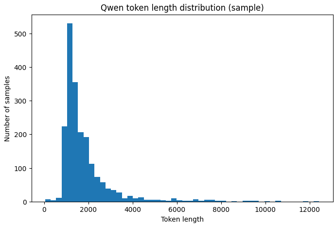
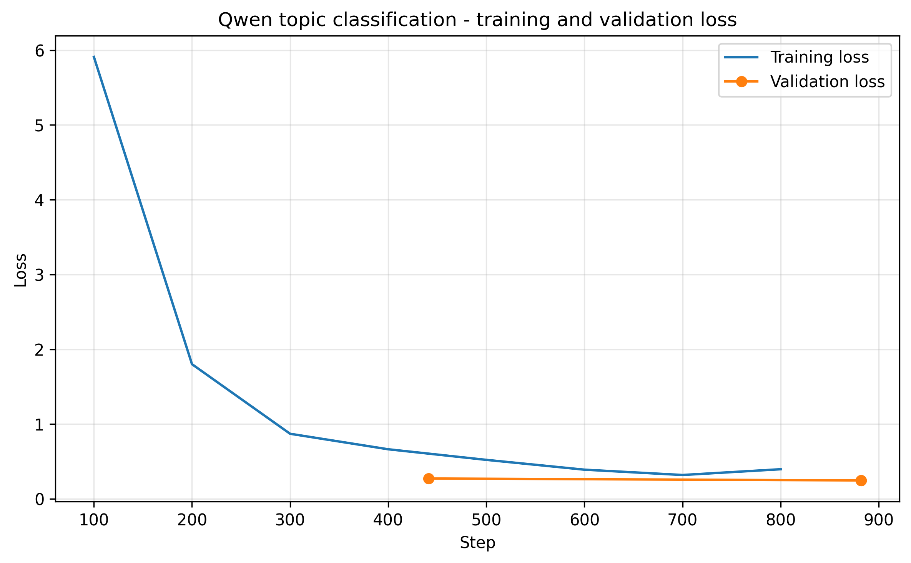
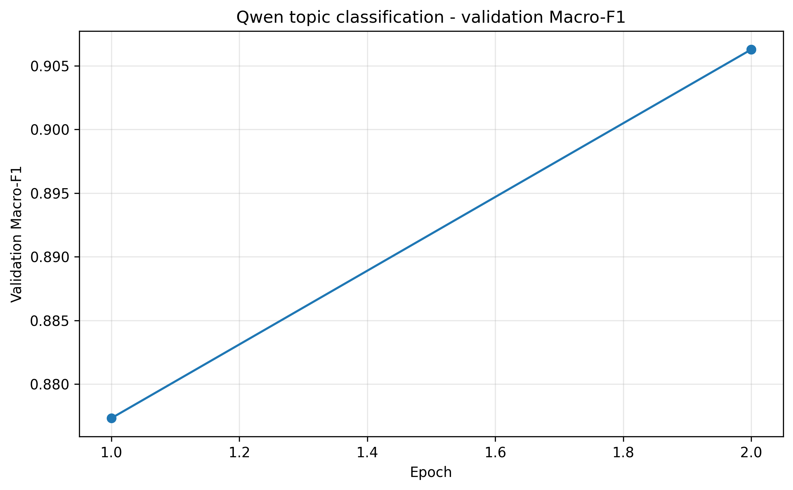
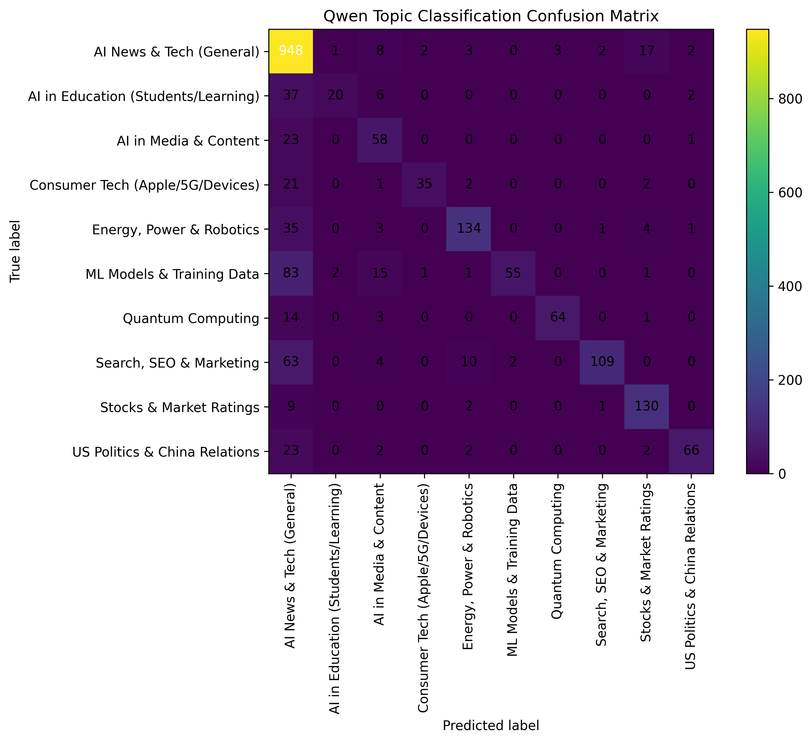
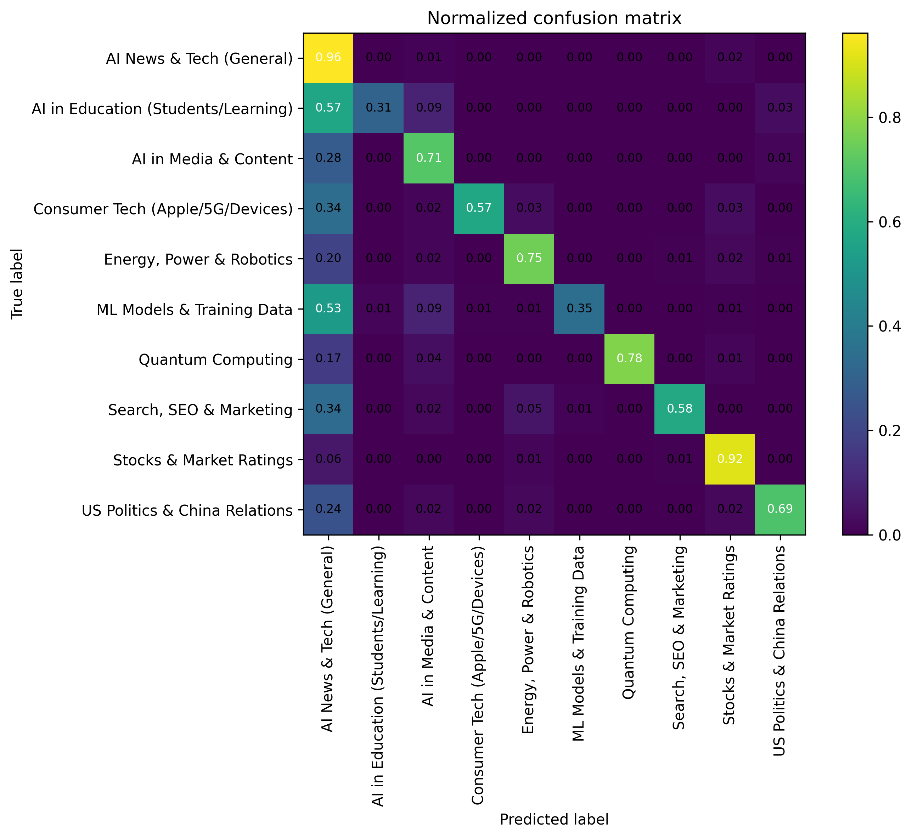

> Note: This Quarto version preserves the original notebook workflow and code for review. Google Colab-specific cells and compute-heavy training cells are kept for documentation, but many are marked with `eval: false` so the report can render from saved local outputs.

> **Environment:** Google Colab Pro (A100 GPU).

## Introduction

This section presents the fine-tuning conducted with **Qwen2.5-1.5B** for the topic classification task in the AI Media Trend Mining project. The objective was to evaluate whether a parameter-efficient fine-tuning strategy could improve classification performance compared with the baseline model.

The original training workflow was executed in Google Colab due to the computational demands of large language model training. For the final Quarto report, the focus is placed on the **saved outputs only**, including evaluation tables, comparison files, confusion matrices, and training curves. This makes the report reproducible and lightweight, while still documenting the full modelling process and the final outcomes.

## Approach

### Task definition

The task in this stage was **topic classification**. Each text sample had to be assigned to a predefined topic category. The experiment compared the performance of:
1. a baseline model before task-specific fine-tuning, and  
2. the final model after LoRA-based fine-tuning.

### General workflow

The overall workflow consisted of the following steps:

1. prepare and tokenize the labelled dataset  
2. load the pretrained Qwen2.5-1.5B base model  
3. apply LoRA adapters for parameter-efficient training  
4. fine-tune the model on the training split  
5. evaluate on validation and test data  
6. save metrics, predictions, plots, and confusion matrices  
7. present the saved results in this Quarto report  

Because the heavy training steps were completed in Colab, this report only reads the stored outputs from the local project folders.


```{python}
#| label: setup
#| code-summary: setup
#| echo: false

from pathlib import Path
import pandas as pd
import json
from IPython.display import Image, display
from sklearn.model_selection import train_test_split
from datasets import Dataset, DatasetDict
import torch
#from transformers import AutoTokenizer, AutoModelForSequenceClassification, BitsAndBytesConfig


BASE_DIR = Path(".")
RESULTS_DIR = BASE_DIR / "results" / "qwen2_5-1_5b" / "results" / "qwen_topic"

```

The report uses the local project structure rather than the original Google Drive paths from Colab. All figures, metrics, and output tables shown below are read directly from the saved files in the project folder.

## Load and inspect data

```{python}
#| label: load_and_inspect
#| code-summary: load_and_inspect_data
#| eval: false

train_df = pd.read_parquet(TRAIN_PATH)
test_df  = pd.read_parquet(TEST_PATH)

print("Train shape:", train_df.shape)
print("Test shape:", test_df.shape)

print("\nColumns:")
print(train_df.columns.tolist())

display(train_df.head(3))
```

### Keep only rows with valid topic labels

```{python}
#| label: keep_valid_rows 
#| eval: false

train_df = train_df.dropna(subset=["topic_label"]).copy()
test_df  = test_df.dropna(subset=["topic_label"]).copy()

print("Train after topic filter:", train_df.shape)
print("Test after topic filter: ", test_df.shape)

print("\nTopic distribution in train:")
print(train_df["topic_label"].value_counts())
```

### Prepare data for topic

We will use 3 columns media_id, full_content and topic_label

```{python}
#| label: prepare_data
#| eval: false
train_df["model_text"] = train_df["full_content"].astype(str)
test_df["model_text"]  = test_df["full_content"].astype(str)

train_df = train_df[["media_id", "model_text", "topic_label"]].copy()
test_df  = test_df[["media_id", "model_text", "topic_label"]].copy()

display(train_df.head(3))
```

### Encode topic labels

```{python}
#| label: topic_labe
#| eval: false
label_list = sorted(train_df["topic_label"].unique().tolist())
label2id = {label: i for i, label in enumerate(label_list)}
id2label = {i: label for label, i in label2id.items()}

train_df["label"] = train_df["topic_label"].map(label2id)
test_df["label"]  = test_df["topic_label"].map(label2id)

print("Number of classes:", len(label_list))
print("\nLabel mapping:")
for k, v in label2id.items():
    print(f"{v}: {k}")
```

### Validation split from train

Creating a validation split from the training set.

```{python}
#| label: add_validation
#| eval: false
#| code-summary: validation_setup
train_df, val_df = train_test_split(
    train_df,
    test_size=0.15,
    random_state=42,
    stratify=train_df["label"]
)

print("Train:", train_df.shape)
print("Val:  ", val_df.shape)
print("Test: ", test_df.shape)
```

## Convert to Hugging Face datasets

```{python}
#| label: Training_dataset
#| eval: false
#| code-summary: hugging_face_dataset
dataset = DatasetDict({
    "train": Dataset.from_pandas(train_df[["model_text", "label"]], preserve_index=False),
    "validation": Dataset.from_pandas(val_df[["model_text", "label"]], preserve_index=False),
    "test": Dataset.from_pandas(test_df[["model_text", "label"]], preserve_index=False),
})

dataset
```

## Load tokenizer and model

We will use the sequence-classification version of Qwen.

```{python}
#| eval: false
#| label: import_tokenizer


MODEL_ID = "Qwen/Qwen2.5-1.5B"

bnb_config = BitsAndBytesConfig(
    load_in_4bit=True,
    bnb_4bit_quant_type="nf4",
    bnb_4bit_use_double_quant=True,
    bnb_4bit_compute_torch_dtype=torch.float16,
)

tokenizer = AutoTokenizer.from_pretrained(MODEL_ID, trust_remote_code=True)

if tokenizer.pad_token is None:
    tokenizer.pad_token = tokenizer.eos_token

model = AutoModelForSequenceClassification.from_pretrained(
    MODEL_ID,
    num_labels=len(label_list),
    id2label=id2label,
    label2id=label2id,
    quantization_config=bnb_config,
    device_map="auto",
    trust_remote_code=True,
)

model.config.pad_token_id = tokenizer.pad_token_id
print("Loaded model.")
```

## Configure LoRA

LoRA, or **Low-Rank Adaptation**, is a parameter-efficient fine-tuning method for large neural networks. Instead of updating all pretrained weights, LoRA adds small trainable low-rank matrices to selected layers of the model. This drastically reduces the number of trainable parameters.

In practical terms, LoRA allows a large language model to adapt to a specific task without the full cost of end-to-end retraining. This makes it a strong choice for rapid experimentation.


::: {.callout-note collapse="true"}
### Lora parameters
`prepare_model_for_kbit_training(model)`  
Prepares the quantized model for stable low-bit fine-tuning.

- used when the base model is loaded in reduced precision, such as 4-bit or 8-bit
- helps make training more stable on limited hardware
- supports parameter-efficient fine-tuning on top of a quantized backbone
- useful in Colab or other memory-constrained environments

`r=16`  
Rank of the low-rank update matrices. r=16 is a middle-ground setting.

- rank 16 gives the adapters a moderate amount of capacity
- larger r = more expressive adapters, but more trainable parameters
- smaller r = lighter and faster training, but less flexibility
- this setting balances efficiency and learning capacity

`lora_alpha=32`  
Scaling factor applied to the LoRA updates. lora_alpha=32 is a standard balanced choice.

- controls how strongly the LoRA updates affect the original model
- larger alpha = stronger contribution of the learned adapter updates
- often chosen in proportion to r
- with r=16 and alpha=32, the setup gives a moderate and commonly used scaling

`target_modules=["q_proj", "v_proj"]`  
Specifies which layers receive LoRA adapters.

- q_proj = query projection in the attention mechanism
- v_proj = value projection in the attention mechanism
- this means only selected attention layers are adapted, not the full model
- reduces the number of trainable parameters

this is a common lightweight LoRA setup for transformer models

`lora_dropout=0.05`  
Dropout applied inside the LoRA adapters. 0.05 is a small regularization setting.

- helps reduce overfitting during fine-tuning
- adds a small amount of noise during training
- lower dropout keeps more learning signal
- 0.05 is a cautious and common choice

`bias="none"`  
Specifies whether bias terms should also be trained. Here, no bias terms were adapted.

- only the LoRA adapter weights are trained  
- keeps the number of trainable parameters lower  
- makes the setup more efficient  
- "none" is a standard choice in many LoRA experiments  

`task_type="SEQ_CLS"`  
Defines the downstream task type as sequence classification.

- tells PEFT that the model is being adapted for classification  
- suitable when one label is predicted for the whole input text  
- appropriate for topic classification tasks  
- not intended for text generation or token-level prediction tasks  
    
:::

```{python}
#| eval: false
#| label: LoRA
from peft import LoraConfig, get_peft_model, prepare_model_for_kbit_training

model = prepare_model_for_kbit_training(model)

lora_config = LoraConfig(
    r=16,
    lora_alpha=32,
    target_modules=["q_proj", "v_proj"],
    lora_dropout=0.05,
    bias="none",
    task_type="SEQ_CLS",
)

model = get_peft_model(model, lora_config)
model.print_trainable_parameters()
```

## Tokenize

Before tokenizing the texts for model training, the length of the input sequences was examined. This step was important because transformer models require a fixed or capped input length, and the choice of maximum sequence length affects both computational cost and the amount of text retained from each example.

### Inspecting the text length distribution

The first step was to inspect the general length of the training texts using simple character and word counts. This provided a quick overview of how long the input documents were before tokenization. At this stage, the goal was not yet to determine the exact sequence length for the model, but rather to identify whether the dataset mainly consisted of short, medium, or very long texts.


loading and filtering the topic rows.

```{python}
#| label: tokenize
#| eval: false

MODEL_ID = "Qwen/Qwen2.5-1.5B"
tokenizer = AutoTokenizer.from_pretrained(MODEL_ID, trust_remote_code=True)

if tokenizer.pad_token is None:
    tokenizer.pad_token = tokenizer.eos_token

## quick text stats using existing model_text
train_df["char_len"] = train_df["model_text"].astype(str).str.len()
train_df["word_len"] = train_df["model_text"].astype(str).str.split().str.len()

print("Character length summary:")
print(train_df["char_len"].describe(percentiles=[0.5, 0.75, 0.9, 0.95, 0.99]))

print("\nWord count summary:")
print(train_df["word_len"].describe(percentiles=[0.5, 0.75, 0.9, 0.95, 0.99]))
```

Actual token lengths were computed on a sample of the training data. The purpose of this step was to assess whether a shorter sequence length such as 256 would be sufficient, or whether a larger cutoff such as 512 would be more appropriate.

```{python}
#| label: token_lengh
#| eval: false
#| 
sample_n = min(2000, len(train_df))
sample_df = train_df.sample(sample_n, random_state=42).copy()

def get_token_length(text):
    return len(tokenizer(str(text), truncation=False, add_special_tokens=True)["input_ids"])

sample_df["token_len"] = sample_df["model_text"].apply(get_token_length)

print("Token length summary on sample:")
print(sample_df["token_len"].describe(percentiles=[0.5, 0.75, 0.9, 0.95, 0.99]))

print("\nCoverage:")
for cutoff in [128, 256, 384, 512, 768]:
    pct = (sample_df["token_len"] <= cutoff).mean() * 100
    print(f"<= {cutoff:>3} tokens: {pct:6.2f}%")
```

::: {.callout-note collapse="true"}
### Token length summary on sample

count     2000.000000  
mean      1828.607000   
std       1276.828233  
min         45.000000  
50%       1431.500000  
75%       1972.500000  
90%       2943.700000  
95%       4027.850000  
99%       7666.470000  
max      12432.000000  
Name: token_len, dtype: float64  

Coverage:  
<= 128 tokens:   0.10%  
<= 256 tokens:   0.30%  
<= 384 tokens:   0.45%  
<= 512 tokens:   0.50%  
<= 768 tokens:   1.05%  
  
This sample-based inspection shows that the dataset contains predominantly very long texts. The median sequence length is already above 1,400 tokens, while the mean is approximately 1,829 tokens. Even a maximum length of 512 tokens covers only 0.50% of the sampled texts, and 768 tokens covers only 1.05%. This indicates that most texts would need to be truncated substantially during model training.

:::


{width=100%}


```{python}
#| label: tokens_max_lenght
#| eval: false
MAX_LENGTH = 512

def tokenize_function(examples):
    return tokenizer(
        examples["model_text"],
        truncation=True,
        padding="max_length",
        max_length=MAX_LENGTH,
    )

tokenized_dataset = dataset.map(tokenize_function, batched=True)
tokenized_dataset = tokenized_dataset.remove_columns(["model_text"])
tokenized_dataset.set_format("torch")

tokenized_dataset
```

## Metrics
The following code defines the evaluation metrics used during fine-tuning.

```{python}
#| label: metrics
#| eval: false
import evaluate
import numpy as np
from sklearn.metrics import classification_report, confusion_matrix

accuracy_metric = evaluate.load("accuracy")
f1_metric = evaluate.load("f1")

def compute_metrics(eval_pred):
    logits, labels = eval_pred
    preds = np.argmax(logits, axis=-1)

    acc = accuracy_metric.compute(predictions=preds, references=labels)
    macro_f1 = f1_metric.compute(predictions=preds, references=labels, average="macro")

    return {
        "accuracy": acc["accuracy"],
        "macro_f1": macro_f1["f1"],
    }
```

## Training Setup

```{python}
#| label: training_setup
#| eval: false
from transformers import TrainingArguments, Trainer

OUTPUT_DIR = "/content/qwen_topic_lora"

training_args = TrainingArguments(
    output_dir=OUTPUT_DIR,
    eval_strategy="epoch",
    save_strategy="epoch",
    logging_strategy="steps",
    logging_steps=100,
    per_device_train_batch_size=8,
    per_device_eval_batch_size=8,
    gradient_accumulation_steps=2,
    num_train_epochs=2,
    learning_rate=2e-4,
    weight_decay=0.01,
    warmup_steps=100,
    load_best_model_at_end=True,
    metric_for_best_model="macro_f1",
    greater_is_better=True,
    fp16=True,
    report_to="none",
    save_total_limit=1,
)

training_args.remove_unused_columns = False

#training_args.disable_tqdm = True

trainer = Trainer(
    model=model,
    args=training_args,
    train_dataset=tokenized_dataset["train"],
    eval_dataset=tokenized_dataset["validation"],
    compute_metrics=compute_metrics,
)

test_results = trainer.evaluate(eval_dataset=tokenized_dataset["test"])
print(test_results)
```

### Baseline evaluation

```{python}
#| label: basline_evaluation
#| eval: false
#| code-summary: evaluation_setup

RESULTS_DIR = PROJECT_DIR / "output" / "results" / "qwen_topic"
RESULTS_DIR.mkdir(parents=True, exist_ok=True)

label_names = [id2label[i] for i in range(len(id2label))]

def evaluate_and_save(trainer, dataset, split_name, stage_name, label_names, results_dir):
    pred_output = trainer.predict(dataset)
    y_true = pred_output.label_ids
    y_pred = np.argmax(pred_output.predictions, axis=-1)

    precision, recall, f1, _ = precision_recall_fscore_support(
        y_true, y_pred, average="macro", zero_division=0
    )
    acc = accuracy_score(y_true, y_pred)

    metrics = {
        "stage": stage_name,
        "split": split_name,
        "accuracy": float(acc),
        "macro_precision": float(precision),
        "macro_recall": float(recall),
        "macro_f1": float(f1),
    }

    ## save metrics json
    with open(results_dir / f"{stage_name}_{split_name}_metrics.json", "w", encoding="utf-8") as f:
        json.dump(metrics, f, indent=2, ensure_ascii=False)

    ## save classification report csv
    report = classification_report(
        y_true, y_pred, target_names=label_names, output_dict=True, zero_division=0
    )
    report_df = pd.DataFrame(report).transpose()
    report_df.to_csv(results_dir / f"{stage_name}_{split_name}_classification_report.csv", index=True)

    ## save confusion matrix csv
    cm = confusion_matrix(y_true, y_pred)
    cm_df = pd.DataFrame(cm, index=label_names, columns=label_names)
    cm_df.to_csv(results_dir / f"{stage_name}_{split_name}_confusion_matrix.csv", index=True)

    ## save row-level predictions
    pred_df = pd.DataFrame({
        "true_label_id": y_true,
        "pred_label_id": y_pred,
        "true_label": [id2label[int(i)] for i in y_true],
        "pred_label": [id2label[int(i)] for i in y_pred],
    })
    pred_df.to_csv(results_dir / f"{stage_name}_{split_name}_predictions.csv", index=False)

    print(f"\n=== {stage_name.upper()} | {split_name.upper()} ===")
    print(pd.DataFrame([metrics]))

    return metrics, report_df, cm_df, pred_df
```

```{python}
#| label: basline_eval
#| eval: false
#| code-summary: baseline_evaluation
baseline_test_metrics, baseline_test_report, baseline_test_cm, baseline_test_preds = evaluate_and_save(
    trainer=trainer,
    dataset=tokenized_dataset["test"],
    split_name="test",
    stage_name="baseline_pretrain",
    label_names=label_names,
    results_dir=RESULTS_DIR,
)

```

```{python}
#| label: train_results4
#| code-summary: baseline-evaluation_result_1
report_df4 = pd.read_csv(RESULTS_DIR / "baseline_pretrain_test_classification_report.csv")
report_df4
```


```{python}
#| label: metric_base
#| code-summary: baseline-evaluation_result_2
json_path = RESULTS_DIR / "baseline_pretrain_test_metrics.json"

with open(json_path, "r", encoding="utf-8") as f:
    metrics = json.load(f)

metrics_df = pd.DataFrame([metrics])
metrics_df
```

## Train


```{python}
#| label: train
#| eval: false
#| code-summary: trainer.train()
trainer.train()
```

::: {.callout-note collapse="true"}
### training output 
/usr/local/lib/python3.12/dist-packages/torch/_dynamo/eval_frame.py:1181: UserWarning: torch.utils.checkpoint: the use_reentrant parameter should be passed explicitly. Starting in PyTorch 2.9, calling checkpoint without use_reentrant will raise an exception. use_reentrant=False is recommended, but if you need to preserve the current default behavior, you can pass use_reentrant=True. Refer to docs for more details on the differences between the two variants.  
  return fn(*args, **kwargs)  

{'loss': '5.91', 'grad_norm': '40.63', 'learning_rate': '0.000198', 'epoch': '0.2268'}  
{'loss': '1.802', 'grad_norm': '24.21', 'learning_rate': '0.0001747', 'epoch': '0.4535'}  
{'loss': '0.8714', 'grad_norm': '26.11', 'learning_rate': '0.0001491', 'epoch': '0.6803'}  
{'loss': '0.6642', 'grad_norm': '12.78', 'learning_rate': '0.0001235', 'epoch': '0.907'}  
{'eval_loss': '0.2735', 'eval_model_preparation_time': '0.0177', 'eval_accuracy': '0.906', 'eval_macro_f1': '0.8773', 'eval_runtime': '19.79', 'eval_samples_per_second': '62.92', 'eval_steps_per_second': '7.884', 'epoch': '1'}  

/usr/local/lib/python3.12/dist-packages/torch/_dynamo/eval_frame.py:1181: UserWarning: torch.utils.checkpoint: the use_reentrant parameter should be passed explicitly. Starting in PyTorch 2.9, calling checkpoint without use_reentrant will raise an exception. use_reentrant=False is recommended, but if you need to preserve the current default behavior, you can pass use_reentrant=True. Refer to docs for more details on the differences between the two variants.  
  return fn(*args, **kwargs)

{'loss': '0.5225', 'grad_norm': '8.307', 'learning_rate': '9.795e-05', 'epoch': '1.134'}  
{'loss': '0.3914', 'grad_norm': '3.071', 'learning_rate': '7.238e-05', 'epoch': '1.361'}  
{'loss': '0.3202', 'grad_norm': '8.823', 'learning_rate': '4.68e-05', 'epoch': '1.587'}  
{'loss': '0.3974', 'grad_norm': '11.43', 'learning_rate': '2.123e-05', 'epoch': '1.814'}  
{'eval_loss': '0.2474', 'eval_model_preparation_time': '0.0177', 'eval_accuracy': '0.9253', 'eval_macro_f1': '0.9063', 'eval_runtime': '19.82', 'eval_samples_per_second': '62.83', 'eval_steps_per_second': '7.872', 'epoch': '2'}  
{'train_runtime': '810.5', 'train_samples_per_second': '17.41', 'train_steps_per_second': '1.088', 'train_loss': '1.27', 'epoch': '2'}
:::

## Save Model

```{python}
#| label: save
#| eval: false
#| code-summary: save_model


## ===== final save paths =====
FINAL_ADAPTER_DIR = PROJECT_DIR / "output" / "models" / "qwen_topic_lora_final"
FINAL_MERGED_DIR = PROJECT_DIR / "output" / "models" / "qwen_topic_full_merged"
FINAL_ADAPTER_DIR.mkdir(parents=True, exist_ok=True)
FINAL_MERGED_DIR.mkdir(parents=True, exist_ok=True)

## ===== 1) save adapter + tokenizer =====
trainer.model.save_pretrained(FINAL_ADAPTER_DIR)
tokenizer.save_pretrained(FINAL_ADAPTER_DIR)

## ===== 2) save label mappings =====
with open(FINAL_ADAPTER_DIR / "label2id.json", "w", encoding="utf-8") as f:
    json.dump(label2id, f, ensure_ascii=False, indent=2)

with open(FINAL_ADAPTER_DIR / "id2label.json", "w", encoding="utf-8") as f:
    json.dump({str(k): v for k, v in id2label.items()}, f, ensure_ascii=False, indent=2)

## ===== 3) save training log =====
log_history = pd.DataFrame(trainer.state.log_history)
log_history.to_csv(FINAL_ADAPTER_DIR / "qwen_topic_training_log.csv", index=False)

## ===== 4) optionally save evaluation metrics =====
eval_metrics = trainer.evaluate()
with open(FINAL_ADAPTER_DIR / "eval_metrics.json", "w", encoding="utf-8") as f:
    json.dump(eval_metrics, f, ensure_ascii=False, indent=2)

print(f"Adapter saved to: {FINAL_ADAPTER_DIR}")
print(f"Training log saved to: {FINAL_ADAPTER_DIR / 'qwen_topic_training_log.csv'}")

## ===== 5) OPTIONAL: merge adapter into base model and save full standalone model =====
## This can take more RAM / disk space.
merged_model = trainer.model.merge_and_unload()
merged_model.save_pretrained(FINAL_MERGED_DIR, safe_serialization=True)
tokenizer.save_pretrained(FINAL_MERGED_DIR)

print(f"Merged full model saved to: {FINAL_MERGED_DIR}")
```

## Evaluate on test set

```{python}
#| label: evaluate
#| eval: false
#| code-summary: evaluation
import torch
import numpy as np
import pandas as pd
from torch.utils.data import DataLoader
from sklearn.metrics import (
    accuracy_score,
    precision_recall_fscore_support,
    classification_report,
    confusion_matrix,
)
from transformers import AutoTokenizer, AutoModelForSequenceClassification, DataCollatorWithPadding

FINAL_MERGED_DIR = PROJECT_DIR / "output" / "models" / "qwen_topic_full_merged"

tokenizer = AutoTokenizer.from_pretrained(FINAL_MERGED_DIR, trust_remote_code=True)
if tokenizer.pad_token is None:
    tokenizer.pad_token = tokenizer.eos_token

model = AutoModelForSequenceClassification.from_pretrained(
    FINAL_MERGED_DIR,
    dtype=torch.float16,
    device_map="auto",
    trust_remote_code=True,
)

model.eval()

test_ds = tokenized_dataset["test"]
data_collator = DataCollatorWithPadding(tokenizer=tokenizer, return_tensors="pt")
test_loader = DataLoader(test_ds, batch_size=8, shuffle=False, collate_fn=data_collator)

all_preds = []
all_labels = []

for batch in test_loader:
    labels = batch["labels"].cpu().numpy()
    all_labels.extend(labels)

    batch = {k: v.to(model.device) for k, v in batch.items() if k != "labels"}

    with torch.no_grad():
        outputs = model(**batch)
        preds = torch.argmax(outputs.logits, dim=-1).cpu().numpy()

    all_preds.extend(preds)

y_true = np.array(all_labels)
y_pred = np.array(all_preds)

acc = accuracy_score(y_true, y_pred)
macro_p, macro_r, macro_f1, _ = precision_recall_fscore_support(
    y_true, y_pred, average="macro", zero_division=0
)
weighted_p, weighted_r, weighted_f1, _ = precision_recall_fscore_support(
    y_true, y_pred, average="weighted", zero_division=0
)

final_test_metrics_df = pd.DataFrame([{
    "accuracy": acc,
    "macro_precision": macro_p,
    "macro_recall": macro_r,
    "macro_f1": macro_f1,
    "weighted_precision": weighted_p,
    "weighted_recall": weighted_r,
    "weighted_f1": weighted_f1,
}])

print("FINAL TEST METRICS")
print(final_test_metrics_df)

label_ids = list(range(len(id2label)))
label_names = [id2label[i] for i in label_ids]

report_df = pd.DataFrame(classification_report(
    y_true,
    y_pred,
    labels=label_ids,
    target_names=label_names,
    output_dict=True,
    zero_division=0
)).transpose()

cm_df = pd.DataFrame(
    confusion_matrix(y_true, y_pred, labels=label_ids),
    index=label_names,
    columns=label_names
)

print("\nPER-CLASS REPORT")
print(report_df)

print("\nCONFUSION MATRIX")
print(cm_df)

REPORT_DIR = PROJECT_DIR / "output" / "results" / "qwen_topic"
REPORT_DIR.mkdir(parents=True, exist_ok=True)

final_test_metrics_df.to_csv(REPORT_DIR / "final_test_metrics_from_merged_model.csv", index=False)
report_df.to_csv(REPORT_DIR / "final_test_classification_report_from_merged_model.csv")
cm_df.to_csv(REPORT_DIR / "final_test_confusion_matrix_from_merged_model.csv")

print(f"\nSaved to: {REPORT_DIR}")
```

```{python}
#| label: train_results
#| code-summary: evaluation_result


report_df = pd.read_csv(RESULTS_DIR / "final_test_classification_report.csv")
report_df
```

**Final Test Overall**

```{python}
#| label: train_results2
#| #| code-summary: evaluation_result2
report_df2 = pd.read_csv(RESULTS_DIR / "final_test_overall_metrics.csv")
report_df2
```

**Fine tuned results vs baseline**

```{python}
#| label: result_vs_baseline
#| eval: false
#| code-summary: evaluation_baseline_vs_fine_tuned
comparison_after_final_df = pd.DataFrame([
    baseline_test_metrics,
    {
        "stage": "final_posttrain_rechecked",
        "split": "test",
        "accuracy": float(final_test_metrics_df.loc[0, "accuracy"]),
        "macro_precision": float(final_test_metrics_df.loc[0, "macro_precision"]),
        "macro_recall": float(final_test_metrics_df.loc[0, "macro_recall"]),
        "macro_f1": float(final_test_metrics_df.loc[0, "macro_f1"]),
    }
])

comparison_after_final_df.to_csv(
    RESULTS_DIR / "baseline_vs_final_rechecked_comparison.csv",
    index=False
)

print(comparison_after_final_df)
```

```{python}
#| label: train_results3
#| code-summary: show_result
report_df3 = pd.read_csv(RESULTS_DIR / "baseline_vs_final_comparison.csv")
report_df3
```

To construct the training labels, topics were first generated using a BERT-based topic modeling approach. These topic assignments were then used as supervision targets for fine-tuning Qwen2.5-1.5B with LoRA as a multi-class text classifier. Therefore, the model does not perform topic discovery itself; rather, it learns to predict the topic labels previously assigned by the BERT-based pipeline. On the test set, performance improved substantially from a pre-training baseline accuracy of 34.3% and macro F1 of 0.081 to a post-training accuracy of 79.4% and macro F1 of 0.720, indicating that the fine-tuned model was effective at reproducing the upstream topic assignments.

Since the supervision labels were generated algorithmically, the reported metrics reflect agreement with the upstream topic model rather than direct validation against manually annotated ground truth.

### Training and Validation Loss

```{python}
#| label: loss_curve
#| eval: false
rain_logs = pd.read_csv(FINAL_ADAPTER_DIR / "qwen_topic_training_log.csv")

loss_logs = train_logs.dropna(subset=["step", "loss"]).copy()
eval_logs = train_logs.dropna(subset=["epoch", "eval_loss"]).copy()

plt.figure(figsize=(8, 5))
plt.plot(loss_logs["step"], loss_logs["loss"], label="Training loss")
plt.plot(eval_logs["step"], eval_logs["eval_loss"], marker="o", label="Validation loss")
plt.xlabel("Step")
plt.ylabel("Loss")
plt.title("Qwen topic classification - training and validation loss")
plt.grid(True, alpha=0.3)
plt.legend()
plt.tight_layout()
plt.savefig(RESULTS_DIR / "qwen_training_validation_loss.png", dpi=300, bbox_inches="tight")
plt.show()
```

{width=100%}

The loss curves indicate that the fine-tuned Qwen model converged effectively during training. Training loss decreased sharply over the course of optimization, while validation loss remained low and improved slightly from the first to the second epoch. This pattern suggests stable learning and does not indicate obvious overfitting within the two-epoch training schedule.

### Macro F1

```{python}
#| label: macro_f1
#| eval: false
plt.figure(figsize=(8, 5))
plt.plot(eval_logs["epoch"], eval_logs["eval_macro_f1"], marker="o")
plt.xlabel("Epoch")
plt.ylabel("Validation Macro-F1")
plt.title("Qwen topic classification - validation Macro-F1")
plt.grid(True, alpha=0.3)
plt.tight_layout()
plt.savefig(RESULTS_DIR / "qwen_validation_macro_f1.png", dpi=300, bbox_inches="tight")
plt.show()
```

{width=100%}

The steady increase in validation Macro-F1 suggests that the model continued to benefit from training through the second epoch, with no evidence of performance deterioration on the validation set.

### Confusion Matrix

```{python}
#| label: confusion_matrix
#| eval: false
cm = cm_df.values
labels = cm_df.index.tolist()

plt.figure(figsize=(10, 8))
plt.imshow(cm, interpolation="nearest")
plt.title("Qwen Topic Classification Confusion Matrix")
plt.colorbar()

tick_marks = np.arange(len(labels))
plt.xticks(tick_marks, labels, rotation=90)
plt.yticks(tick_marks, labels)

threshold = cm.max() / 2 if cm.size > 0 else 0
for i in range(cm.shape[0]):
    for j in range(cm.shape[1]):
        plt.text(
            j, i, str(cm[i, j]),
            ha="center", va="center",
            color="white" if cm[i, j] > threshold else "black"
        )

plt.xlabel("Predicted label")
plt.ylabel("True label")
plt.tight_layout()
plt.savefig(RESULTS_DIR / "final_test_confusion_matrix.png", dpi=300, bbox_inches="tight")
plt.show()
```

{width=100%}


::: {.callout-note collapse="true"}
### confusion matrix normalized 

```{python}
#| label: confusion_matrix2
#| eval: false
cm = cm_df.values.astype(float)

## Row-normalize
row_sums = cm.sum(axis=1, keepdims=True)
cm_norm = np.divide(cm, row_sums, out=np.zeros_like(cm), where=row_sums != 0)

labels = cm_df.index.tolist()

plt.figure(figsize=(10, 8))
plt.imshow(cm_norm, interpolation="nearest")
plt.title("Normalized confusion matrix")
plt.colorbar()

tick_marks = np.arange(len(labels))
plt.xticks(tick_marks, labels, rotation=90)
plt.yticks(tick_marks, labels)

threshold = cm_norm.max() / 2 if cm_norm.size > 0 else 0
for i in range(cm_norm.shape[0]):
    for j in range(cm_norm.shape[1]):
        plt.text(
            j, i, f"{cm_norm[i, j]:.2f}",
            ha="center", va="center",
            color="white" if cm_norm[i, j] > threshold else "black",
            fontsize=8
        )

plt.xlabel("Predicted label")
plt.ylabel("True label")
plt.tight_layout()
plt.savefig(RESULTS_DIR / "normalized_confusion_matrix.png", dpi=300, bbox_inches="tight")
plt.show()
```

{width=100%}

The normalized confusion matrix shows the proportion of documents in each true topic class that were assigned to each predicted class. Diagonal values indicate correct classification rates per class, while off-diagonal values highlight systematic topic confusions. This representation is especially useful when class sizes are imbalanced, as it emphasizes relative rather than absolute performance.

:::
